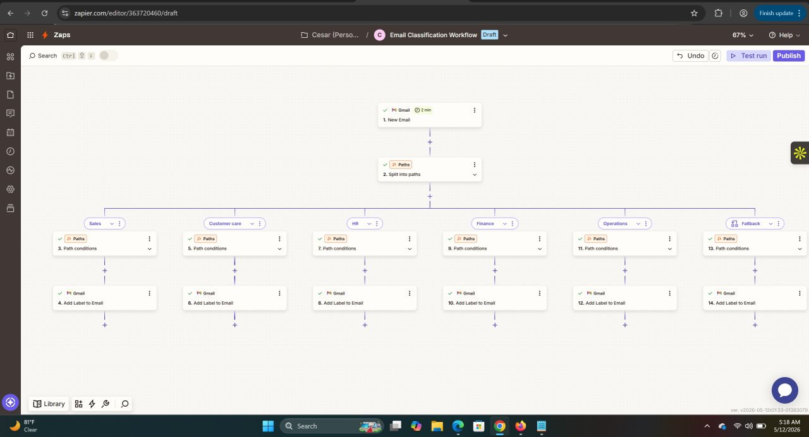
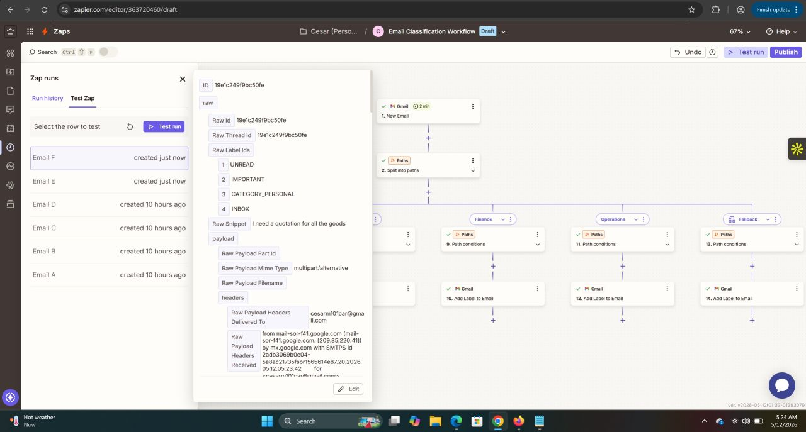
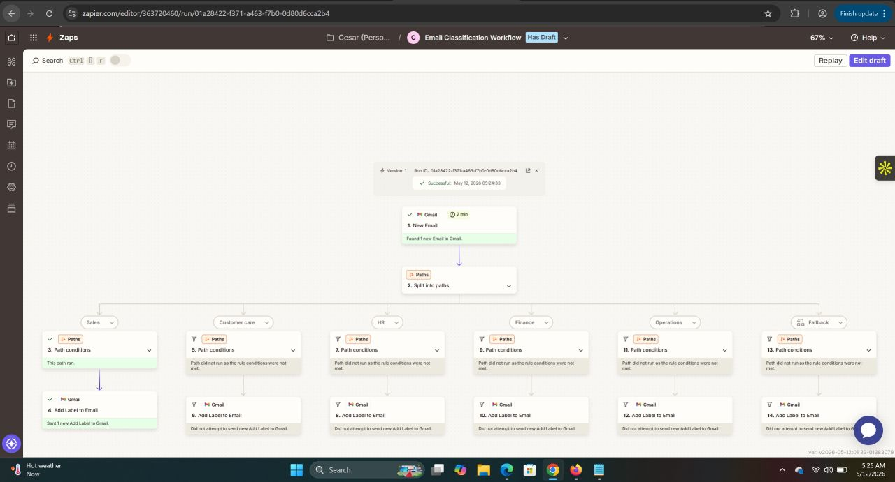
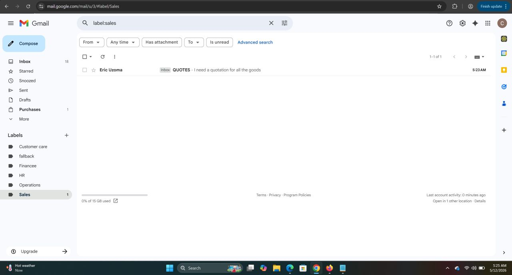

# AI Email Classification System

An automated email classification and departmental routing workflow built with **Zapier and Gmail**.

## Project Overview

Managing a high volume of emails manually can be time-consuming. This project automates email organization by routing incoming messages into relevant departmental categories based on predefined conditions.

## How It Works

1. **Email Trigger:** Gmail detects a new incoming email.
2. **Path Routing:** Zapier evaluates the email against predefined conditions.
3. **Department Classification:** The workflow routes emails into categories such as Sales, Customer Care, HR, Finance, and Operations.
4. **Automated Labeling:** Gmail applies the corresponding label to organize each email.
5. **Fallback Handling:** Emails that do not match the defined departmental conditions follow the fallback path.

## Key Features

- Automated email processing
- Conditional routing with Zapier Paths
- Department-based email classification
- Automatic Gmail labeling
- Fallback handling for unmatched emails

## Technologies Used

- **Zapier** — Workflow automation and conditional logic
- **Gmail** — Email trigger and label management

## Project Screenshots

Screenshots of the workflow, test runs, and email routing will be added here.

## Business Value

This project demonstrates how workflow automation can reduce manual email sorting, improve organization, and help teams manage incoming communications more efficiently.

## Disclaimer

This is a portfolio project demonstrating email classification and workflow automation. Classification depends on the configured rules and conditions.
### Workflow Overview

### Gmail Email Test

### Successful Workflow Execution

### Sales Email Label

### Email Routing Overview

## Project Demo

🎥 [Watch the Email Classification System Demo] (https://lnkd.in/p/epkBWShA))
